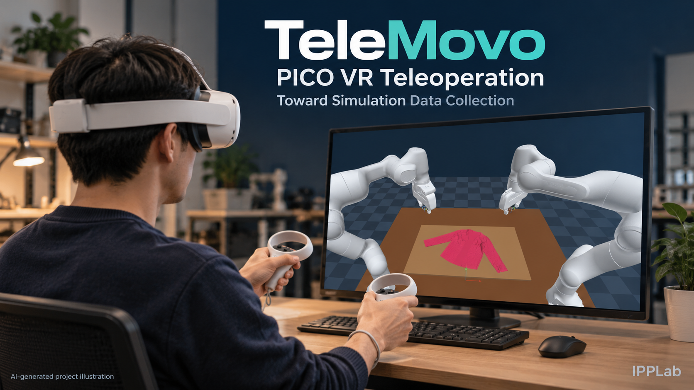

# TeleMovo

**面向 PICO 的浏览器沉浸式机器人遥操平台**

*封面为参考现有仿真场景制作的 AI 项目示意图，不是已验证采集过程的实拍照片。*

TeleMovo 将 PICO 手柄、沉浸式场景和双臂仿真连接起来。当前提供 Genesis PBD
布料场景、双 Franka Panda 和双 X5 示例，目标是让操作者在浏览器中进入场景，
理解手柄方向，并逐步完成双臂操作。

我们希望将它逐步建设为面向仿真数据采集的平台：从沉浸式遥操出发，补齐录制、
回放、质检和数据集导出。当前版本提供遥操基础，episode 录制和导出仍待实现。

[English](README.md) · [安装与启动](docs/setup.zh-CN.md) · [资产准备](docs/assets.zh-CN.md) · [PICO 操作](docs/operation.zh-CN.md) · [架构与接口](docs/architecture.md) · [结果与限制](docs/results.zh-CN.md)

## 当前可以做什么

- 在 PICO 浏览器进入双眼立体场景，转头、探身查看机器人和衣物。
- 用双 Grip 相对移动双臂，用 Trigger 控制夹爪；松开 Grip 可以重新摆放手柄。
- 使用桌面坐标、锁定朝向、TCP 方向轴和台边练习说明来理解控制。
- 切换 Franka Panda／X5 配置，运行碰撞、可达性、控制自检和物理测速。
- 将仿真与 HTTPS 网关放在同机或不同机器，通过可选 SSH 隧道连接。

主线采用 **服务器计算物理、头显本地绘制**，没有 CloudXR 桌面视频串流。
它仍需要渲染，只是实时显示由头显浏览器承担；高质量训练图像属于另一个流程。

## 必须先知道的状态

这是实验原型。已经进行过实际 PICO 双臂遥操，但操作者反馈仍然难操作，尚未达到
稳定采集。布料的可靠夹取、释放与折叠没有通过完整验证；X5 固定抓点抬升测试失败。
控制自检通过不等于衣物任务成功，接近 1× 的物理实时倍率也不等于头显达到 60 FPS。

当前版本没有真机驱动，也不包含 episode 录制、成功失败标记或 LeRobot 导出。
此前 Isaac／CloudXR 和数据工作台的实验不在这个仓库里。通用接口是后续发展方向，
目前只声明实际验证过的 PICO 与 Genesis 示例。

## 开始使用

1. 根据[安装文档](docs/setup.zh-CN.md)准备现有 GPU Python 环境、固定版本 Genesis 和网关依赖。
2. 按[资产文档](docs/assets.zh-CN.md)导入自备模型、衣物；仓库不携带这些第三方网格。
3. 应用隔离接触补丁，启动一个机器人仿真，再启动 HTTPS 网关。
4. PICO 打开 `https://你的局域网IP:8444/?teleop=1`（Franka）或端口 `8445`（X5）。
5. 松开双 Grip 进入 VR，先练习单臂小幅移动，再试夹爪和双臂配合。

启动命令支持 `--dry-run`。默认仿真运行 1800 秒，可通过 `--seconds` 指定；Ctrl+C
停止前台进程。仓库整理和 CPU 测试不会自动启动任何仿真。

## 欢迎一起建设 TeleMovo

欢迎贡献代码、提交问题，也欢迎第一次参与机器人项目的开发者。没有 PICO 或 GPU，
也可以从文档、CPU 测试和安装步骤开始。我们尤其期待这些方向的贡献：

- **操作体验**：方向映射、Grip 重锚定、手腕旋转与更清晰的操作引导。
- **适配扩展**：新增机器人和仿真后端，并提供明确的验证方法。
- **数据采集**：episode 录制、成功失败标记、连续回放、质检和 LeRobot 导出。
- **复现与测试**：资产准备、环境安装、实际头显性能测量及失败案例分析。

[报告问题／提出想法](https://github.com/codeofwhite/telemovo/issues/new)
· [查看 Issues](https://github.com/codeofwhite/telemovo/issues)
· [贡献指南](CONTRIBUTING.md)
· [提交 PR](https://github.com/codeofwhite/telemovo/pulls)

小修复、失败测试记录和真实操作反馈同样有价值。较大改动请先开 Issue，说明目标、
修改范围和验证方式，再开始实现。

## 文档导航

| 文档 | 内容 |
|---|---|
| [安装与启动](docs/setup.zh-CN.md) | 依赖、补丁、同机／远端、证书与停止 |
| [资产准备](docs/assets.zh-CN.md) | 来源、哈希、导入与衣物导出 |
| [操作说明](docs/operation.zh-CN.md) | 按键、校准、方向、锁定／自由旋转 |
| [架构与协议](docs/architecture.md) | 输入、坐标、状态包及适配边界 |
| [实验结果](docs/results.zh-CN.md) | 已有证据、失败结果与性能边界 |
| [故障排查](docs/troubleshooting.zh-CN.md) | 页面打不开、无响应、卡顿与滑布 |
| [验证说明](docs/verification.zh-CN.md) | CPU 检查及需要硬件的手工验证 |
| [贡献说明](CONTRIBUTING.md) | 提交问题、复现实验与扩展方向 |

当前没有项目整体开源许可证，需由所有者在公开开源发布前选定。第三方材料的来源
与许可单独列在[第三方说明](THIRD_PARTY_NOTICES.md)。本项目是独立社区实验，非 PICO 官方产品。
