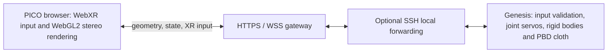

# Architecture and interface



Same-host deployments connect the gateway directly to the loopback simulation
port. The gateway is independent of the simulator process; stopping it does not
stop a remote simulation. The scene runs with `show_viewer=False`. Native GPU
physics stays on the server; the headset draws geometry and live vertex/link
updates. This avoids the CloudXR path used in earlier experiments.

## Modules and data flow

| File | Responsibility |
|---|---|
| `simulation/configuration.py` | Resolve selected profile, asset paths and physics/control cadence |
| `simulation/robot_profiles.py` | Model import type, joints, TCP links and robot bases |
| `simulation/teleop_control.py` | Scene construction, joint servo targets, input ownership, reset and tracking guards |
| `simulation/live.py` | Physics loop, state sampling, geometry construction and loopback WebSocket service |
| `viewer/gateway.py` | HTTPS static files and bounded forwarding of `/state` and `/control` |
| `viewer/viewer.js` | Local stereo rendering, head/controller calibration, input and operation guides |
| `scripts/launch.py` | Environment selection, asset/patch preflight, process launch and optional SSH lifecycle |

The existing control and geometry code is deliberately retained. This packaging
does not introduce a simulator abstraction or certify arbitrary robot profiles.
New robots need a description, joint/link mapping, gains, limits, TCP, collision
layout and validation. Other simulators need an explicit protocol adapter; they
cannot be selected with a config flag today.

## Connections

- Simulation binds only `127.0.0.1:9740` (Franka) or `:9742` (X5).
- Gateway defaults to loopback `:8444` or `:8445`; select the LAN address explicitly.
- `/` is a read-only viewer, `/?teleop=1` requests control.
- `/health` checks the gateway, not simulation readiness or physics health.
- WSS `/state` permits no client messages; WSS `/control` forwards only the
  recognized `xr`, `hold` and `reset` message types. Simulation must also have
  been started with `--teleop`.
- Optional SSH forwarding uses loopback ports `9741→9740` or `9743→9742`.

The gateway permits up to 64 MiB per upstream message because an observed X5
initial geometry packet was approximately 48 MB. Incoming control frames are
bounded at 4096 bytes. Mesh transfer is not optimized for slow WAN connections.
The gateway has no internet-facing authentication layer.

## Coordinates and input protocol v1

Physics uses Z-up metres. Quaternions transmitted by this interface use XYZW;
Genesis native link quaternions are converted from WXYZ. The viewer maps
simulation axes to WebXR and uses a separate yaw-only anchor for table-aligned
controller movement. Headset stereo view transforms remain active.

```json
{
  "type": "xr", "version": 1, "sequence": 1,
  "input_frame": "table", "rotation_mode": "locked",
  "hands": {
    "left":  {"pose": [0,0,1,0,0,0,1], "valid": true, "grip": false, "trigger": 0},
    "right": {"pose": [0,0,1,0,0,0,1], "valid": true, "grip": false, "trigger": 0}
  }
}
```

Both hands must be present. Invalid tracking uses `valid:false`; it is not
replaced by a synthesized pose. The server checks finite pose values, quaternion
norm, trigger bounds, version, owner and increasing sequence number. The live
controller also checks tracking jumps, workspace, following error and joint
limits. A stale input timeout of 0.25s disarms following and requires release.
These are simulation guards, not a real-robot safety certification.

The client attempts 60 Hz input from XR animation callbacks. Servo updates are
50 Hz **simulation time**; physics dt is 0.004s with four substeps. If physics
runs at 0.6× wall-clock real time, that control cadence is about 30 Hz in wall
time. Publishing/input frequency must not be confused with robot response rate.

## Geometry and state protocol v2

Each connection first receives a JSON `geometry` message: version 2, base64
Float32 vertices, Uint32 triangle indices, link pose indices, initial poses,
cloth particle count, platform description, two TCP descriptors and control
availability. Mesh topology is fixed during a session. The cloth vertex count
must match the solver particle count; incompatible geometry fails explicitly.

Binary updates have this little-endian header (`<4sIddddII`, 48 bytes):

| Offset | Type | Meaning |
|---|---|---|
| 0 | 4 bytes | `GSV2` magic |
| 4 | uint32 | Sequence |
| 8 | float64 | Simulation seconds |
| 16 | float64 | Server epoch seconds |
| 24 | float64 | Physics real-time factor |
| 32 | float64 | State publication rate |
| 40 | uint32 | Cloth particle count |
| 44 | uint32 | Robot link pose count |

Payload: `particle_count × 3` Float32 cloth XYZ values followed by
`pose_count × 7` Float32 link XYZ + quaternion XYZW values. The service targets
20 Hz state publication in wall time. A following JSON `control` message reports
accepted/rejected input, input age, release requirement, targets and errors.
These packets and diagnostic status files are not a demonstration dataset.

## Contact model

The pinned patch adds per-rigid-geometry Coulomb friction to Genesis's legacy
PBD/rigid coupling. Table/platform and finger pads can be configured separately.
It also changes normal reaction accounting and bounce from depenetration. There
are no grasp attachments, particle binding or adhesion. These experimental
coefficients are not a calibration to real fabric or a reproduction of PhysX's
material model. The shared upstream installation is never patched in place.
